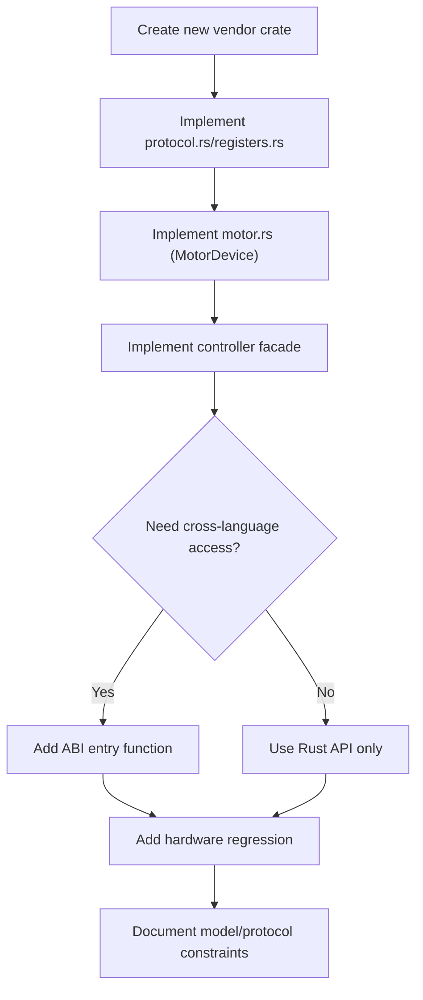

# Extending motorbridge

## Vendor Onboarding Flow

## Add a New Vendor (example: RobStride)

Goal: keep `motor_core` unchanged; add a new vendor crate.

1. Create crate (for example `motor_vendor_robstride`).
2. Implement vendor layers:
   - `protocol.rs`
   - `registers.rs`
   - `motor.rs` (implement `motor_core::MotorDevice`)
   - `controller.rs` (facade over `CoreController`)
3. Expose vendor access from ABI if needed (for example `motor_controller_add_robstride_motor`).
4. Add crate to workspace members.

## Add a New CANopen-Camp Vendor (example: Huayi)

CANopen vendors do not reinvent the protocol: SDO framing, COB-ID rules, CiA402 state-machine sequences, PDO reconfiguration, node scanning, and NMT all live in the shared `motor_canopen` framework; vendor crates keep only the semantic differences. RobStride (proprietary CAN, CiA402-style state machine) and Huayi (standard CANopen) share this layer, and both can coexist on one classic CAN bus.

Four onboarding steps (Huayi is the reference; code in `motor_vendors/huayi/`):

1. Create crate `motor_vendor_<name>`, depending on `motor_canopen` and `motor_core`.
2. Define the trio — where all differences live:
   - `objects.rs`: object-dictionary entries (index, sub-index, data type) plus vendor-private 2xxx/3xxx objects;
   - units and scaling: Huayi uses pos/vel Float32 Rev (output shaft)/Rev/s, torque Int16 per-mille of peak (6076h), temperature Int16 0.1°C (2204h);
   - mode enum mapped to `6060h` values: **check the manual for the numbering semantics first** (Huayi `5=MIT`, RobStride proprietary `5=CSP` — same number, different meaning, must be verified per vendor).
3. Compose `CanopenNode`: pass in the COB-ID layout, default PDO config, mode table, and scaling; the framework provides the procedural capabilities — SDO read/write, CiA402 enable/disable sequences, TPDO stream decoding, and so on.
4. Add the ABI entry `motor_controller_add_<name>_motor` plus vendor extension functions, and align all four frontends (bindings / CLI / ws_gateway / api_surface.json).

Attribution rule: "how frames are sent and how the handshake goes" belongs to `motor_canopen`; "what unit this value is, which index, which mode number" belongs to the vendor crate. When unsure, push it down into the framework so the next CANopen vendor reuses it directly.

## Add Models Under Existing Vendor (Damiao)

1. Open `motor_vendors/damiao/src/motor.rs`.
2. Extend model catalog entries (`model`, `pmax`, `vmax`, `tmax`).
3. Keep model strings consistent with user input.

## Protocol Compatibility Rule

Do not assume same-vendor models are always protocol-identical.
Validate at least:

- frame structure and arbitration IDs
- register mapping and data type
- control mode mapping
- limit ranges and scaling
- status/error semantics

If any differs, split implementation by sub-protocol profile.

## Suggested Hardware Regression

1. `enable -> ensure_mode(MIT) -> zero command`
2. trajectory follow test (position/velocity/torque)
3. register read/write validation (`rid=10` and critical R/W registers)
4. clear-error and recovery path
5. 10-30 min stability run
