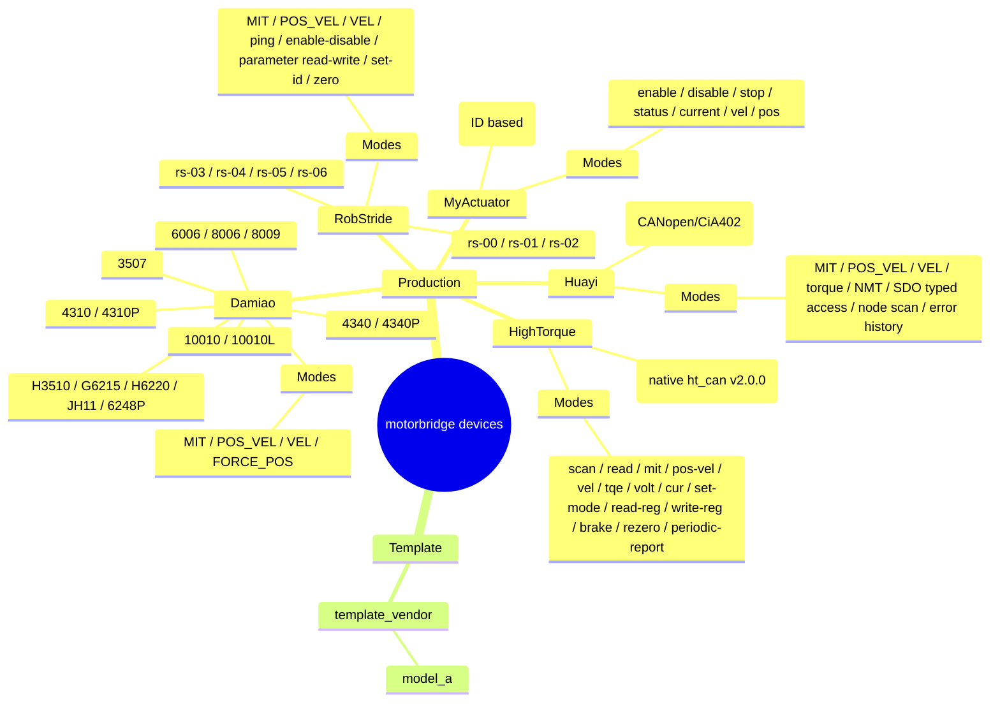

# 支持设备

<!-- channel-compat-note -->
## 通道兼容说明（PCAN + CANable candleLight/gs_usb + MCU 串口转 CAN 桥 + Damiao 串口桥 + DM_Device）

- Linux SocketCAN 直接使用已初始化的接口名：`can0`、`can1`。CANable 请刷 candleLight/gs_usb 固件，让系统识别为 `can0` 这类 SocketCAN 接口。
- 标准 CAN 推荐 PCAN 或 CANable candleLight/gs_usb。
- 仅 Damiao 提供串口桥链路（CLI）：`--transport dm-serial --serial-port /dev/ttyACM0 --serial-baud 921600`。
- 通用 MCU 串口转 CAN 桥：`--transport mcu-serial --serial-port /dev/ttyACM0 --serial-baud 921600`。注意与 Damiao 专用串口桥 `dm-serial` 是两种协议：`mcu-serial` 由桥固件透传经典 CAN 帧，`dm-serial` 承载 Damiao 串口协议。适配经典 CAN 全品牌（damiao / robstride / myactuator / hightorque / huayi；hexfellow 仅 CAN-FD 不适用）；桥固件在 bus-off / 发送失败 / 接收丢弃时会主动上报结构化链路状态；四个前端（motor_abi / Python / motor_cli / ws_gateway）均支持。
- Linux SocketCAN 下 `--channel` 不要带 `@bitrate`（例如 `can0@1000000` 无效）。
- Windows（PCAN 后端）中，`can0/can1` 映射到 `PCAN_USBBUS1/2`，可选 `@bitrate` 后缀。

## 支持全景图

## 生产可用支持

| 品牌 | 型号 | 控制模式 | 寄存器读写 | ABI 覆盖 | 说明 |
|---|---|---|---|---|---|
| Damiao | 3507, 4310, 4310P, 4340, 4340P, 6006, 8006, 8009, 10010L, 10010, H3510, G6215, H6220, JH11, 6248P | scan, enable, disable, MIT, POS_VEL, VEL, FORCE_POS, set-id, set-zero | 支持（f32/u32） | 支持 | 生产基线；修改 ID 建议使用 `--store 1 --verify-id 1` |
| RobStride | rs-00, rs-01, rs-02, rs-03, rs-04, rs-05, rs-05el, rs-06 | scan, ping, enable, disable, MIT, POS_VEL, VEL, parameter read/write, set-id, zero | 支持（i8/u8/u16/u32/f32） | 支持 | 使用 29-bit 扩展 CAN ID；默认 host/feedback ID 为 `0xFD`；set-id 对齐上位工具帧布局 |
| MyActuator | X-series（运行时 model 字符串，默认 `X8`） | enable, disable, stop, status, current, vel, pos, version, mode-query | 暂不支持（CLI 命令级支持） | 支持 | 使用标准 11-bit ID：`0x140+id` / `0x240+id`；常用 ID 范围 1..32 |
| HighTorque | hightorque（运行时 model 字符串；原生 `ht_can` v2.0.0） | scan, read, MIT, POS_VEL, POS_VEL_ACC（梯形 07 2d）, VEL, POS_CLASSIC（07 07）, torque（力矩 05 13）, dq_voltage（DQ 电压）/ dq_current（DQ 电流）, set-mode（运行模式切换）, periodic-report（周期上报）, read-reg（17 族通用寄存器读）, write-reg（通用寄存器写）, stop, brake（模式 15）, rezero | 暂不支持（vendor 命令级支持） | 支持 | 对外统一 `rad/rad/s/Nm/V/A` 物理量接口（力矩/电压/电流由 vendor 侧编码并做型号力矩系数补偿）；MIT 走 `0x18000 \| id` 位打包帧（固件 v4.6.0+），原生 payload 缩放由实现层处理 |
| Huayi | huayi-joint（运行时 model 字符串，仅为标签） | scan（节点扫描）, enable, disable, MIT（含压缩 RPDO4 快速通道）, POS_VEL, VEL, torque（6060h=4 + 6071h）, position preset（3001h 置零/预设）, set-node-id（2001h）, NMT, error history（1003h）, store/restore（1010h/1011h） | 类型化 SDO（u16/i16/i32/f32，16 位索引） | 支持 | 经典 CAN 上的 CANopen/CiA402；节点号 1..=127；与 RobStride 同走 CANopen 语义栈（motor_canopen 公用框架），但模式编号语义不同（6060h=5 是 MIT，非 RobStride 私有协议的 CSP）；混总线需经典 CAN（1 Mbit/s），Hexfellow 的 CAN-FD 总线不适用；置零须先 disable（同 Damiao） |

## 模板（非生产）

| 品牌 | 型号 | 控制模式 | 寄存器读写 | ABI 覆盖 | 说明 |
|---|---|---|---|---|---|
| template_vendor | model_a（占位） | 占位实现 | 占位实现 | 不支持 | 新厂商接入模板 |

## 模式说明

- MIT：位置 + 速度 + 刚度 + 阻尼 + 力矩前馈
- POS_VEL：位置 + 速度限制
- VEL：速度控制
- FORCE_POS：位置 + 速度限制 + 力矩比例

