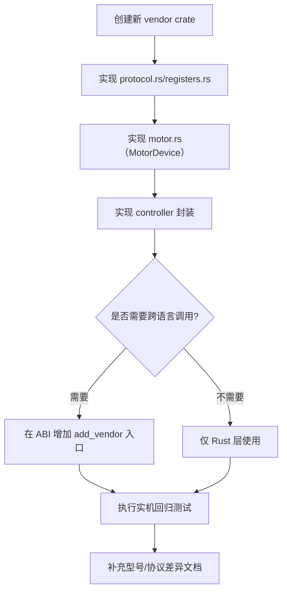

# 扩展开发指南

## 厂商接入流程图

## 新增品牌（例如 RobStride）

目标：不改 `motor_core`，只新增 vendor crate。

1. 新建 crate（例如 `motor_vendor_robstride`）。
2. 在 crate 内实现：
   - `protocol.rs`
   - `registers.rs`
   - `motor.rs`（实现 `motor_core::MotorDevice`）
   - `controller.rs`（封装 `CoreController`）
3. 如需跨语言调用，在 ABI 中增加接入函数（例如 `motor_controller_add_robstride_motor`）。
4. 在 workspace 里注册新 crate。

## 新增 CANopen 阵营厂商（例如 Huayi）

CANopen 厂商不重复造协议轮子：SDO 帧、COB-ID 规则、CiA402 状态机序列、PDO 重配置、节点扫描、NMT 都在 `motor_canopen` 公用框架里，vendor crate 只保留"语义差异"。RobStride（私有 CAN，走 CiA402 式状态机）与 Huayi（标准 CANopen）共用这一层，且一条经典 CAN 总线上两者可共存。

接入四步（以 Huayi 为参照，代码在 `motor_vendors/huayi/`）：

1. 新建 crate `motor_vendor_<name>`，依赖 `motor_canopen` 与 `motor_core`。
2. 定义三件套——差异的全部所在：
   - `objects.rs`：对象字典条目（索引、子索引、数据类型）与厂商私有 2xxx/3xxx 对象；
   - 单位与缩放：Huayi 为 pos/vel Float32 Rev（输出轴）/Rev/s、力矩 Int16 峰值千分比（6076h）、温度 Int16 0.1°C（2204h）；
   - 模式枚举到 `6060h` 值的映射：**先对照手册确认编号语义**（Huayi `5=MIT`，RobStride 私有协议 `5=CSP`——同号不同义，必须逐厂核对）。
3. 组合 `CanopenNode`：传入 COB-ID 布局、默认 PDO 配置、模式表与缩放，由框架提供 SDO 读写、CiA402 启停序列、TPDO 流解析等过程性能力。
4. 在 ABI 增加 `motor_controller_add_<name>_motor` 入口与厂商扩展函数，四个前端（bindings / CLI / ws_gateway / api_surface.json）对齐。

归属原则：凡"怎么发帧、怎么握手"归 `motor_canopen`；凡"这个值是什么单位、哪个索引、哪个模式号"归 vendor crate。拿不准时优先下放框架，让下一个 CANopen 厂商直接复用。

## 新增同品牌型号（Damiao）

1. 打开 `motor_vendors/damiao/src/motor.rs`。
2. 在型号目录中添加新条目（`model`、`pmax`、`vmax`、`tmax`）。
3. 保持型号字符串与调用侧输入一致。

## 协议兼容原则

不要假设同品牌不同型号协议必然一致，至少验证：

- 帧结构与 arbitration ID 规则
- 寄存器映射与数据类型
- 控制模式映射
- 范围参数与缩放关系
- 状态/故障语义

任何一项不一致，都建议在 vendor 内按子协议拆分实现。

## 建议最小回归清单

1. `enable -> ensure_mode(MIT) -> 零指令`
2. 轨迹跟随（位置/速度/力矩）
3. 寄存器读写验证（含 `rid=10` 及关键寄存器）
4. 清错与恢复流程
5. 10-30 分钟稳定性测试
