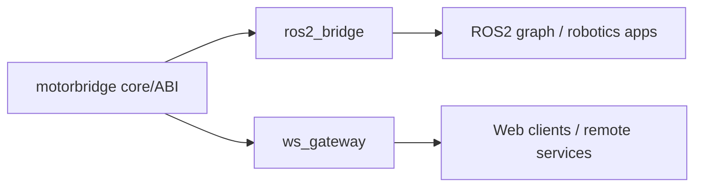

# Integrations

<!-- channel-compat-note -->
## Channel Compatibility (PCAN + CANable candleLight/gs_usb + MCU Serial Bridge + Damiao Serial Bridge + DM_Device)

- Linux SocketCAN uses prepared interfaces directly: `can0`, `can1`. For CANable, use candleLight/gs_usb firmware so it appears as a SocketCAN interface such as `can0`.
- Use PCAN or CANable candleLight/gs_usb for standard CAN.
- Damiao-only adapter transports are available in CLI: serial bridge (`--transport dm-serial --serial-port /dev/ttyACM0 --serial-baud 921600`) and DM_Device SDK (`--transport dm-device --dm-device-type usb2canfd|usb2canfd-dual|linkx4c --dm-channel 0|1|2|3`; Damiao motors only; adapter must be in USB mode).
- Generic MCU UART-to-CAN bridge: `--transport mcu-serial --serial-port /dev/ttyACM0 --serial-baud 921600`. Note this is a different protocol from the Damiao-only `dm-serial` bridge: `mcu-serial` relays classic CAN frames through the bridge firmware, while `dm-serial` carries the Damiao serial protocol. It covers all classic-CAN vendors (damiao / robstride / myactuator / hightorque / huayi; hexfellow is CAN-FD-only and not supported); the bridge firmware proactively reports structured link status on bus-off / TX failure / RX drop, and all four frontends (motor_abi / Python / motor_cli / ws_gateway) support it.
- Full Damiao serial-bridge interface list and command patterns are documented in `motor_cli/README.md` (section `3.6` in `motor_cli/README.zh-CN.md`).
- On Linux SocketCAN, do not append bitrate in `--channel` (for example `can0@1000000` is invalid).
- On Windows (PCAN backend), `can0/can1` map to `PCAN_USBBUS1/2`; optional `@bitrate` suffix is supported.

Production-oriented bridge adapters live here.

- `ros2_bridge/`: ROS2 integration (implemented)
- `ws_gateway/`: Rust WebSocket gateway (implemented, V1 JSON over WS)

## Experimental Windows Support (PCAN-USB)

Linux remains the primary target. Windows support is experimental and currently uses PEAK PCAN.

- Install PEAK PCAN driver + PCAN-Basic runtime (`PCANBasic.dll`).
- Use `can0@1000000` for Windows channel+bitrate in CLI/gateway commands.
